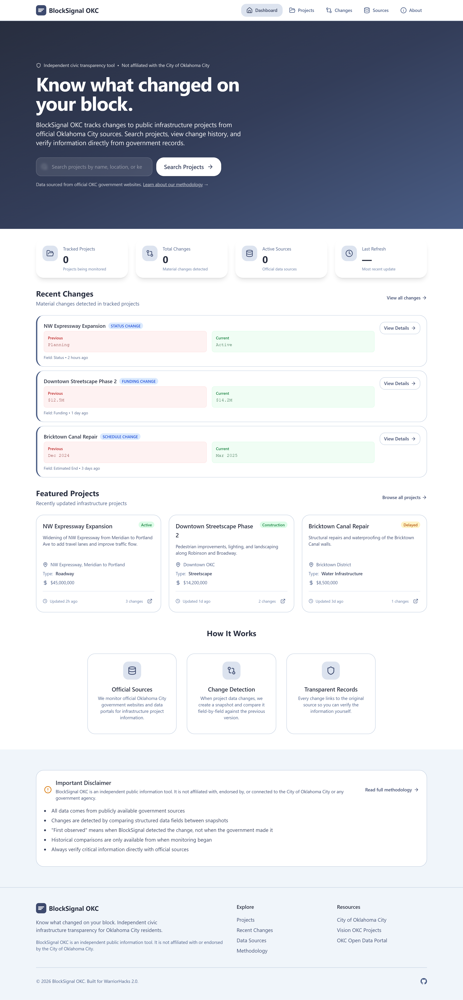
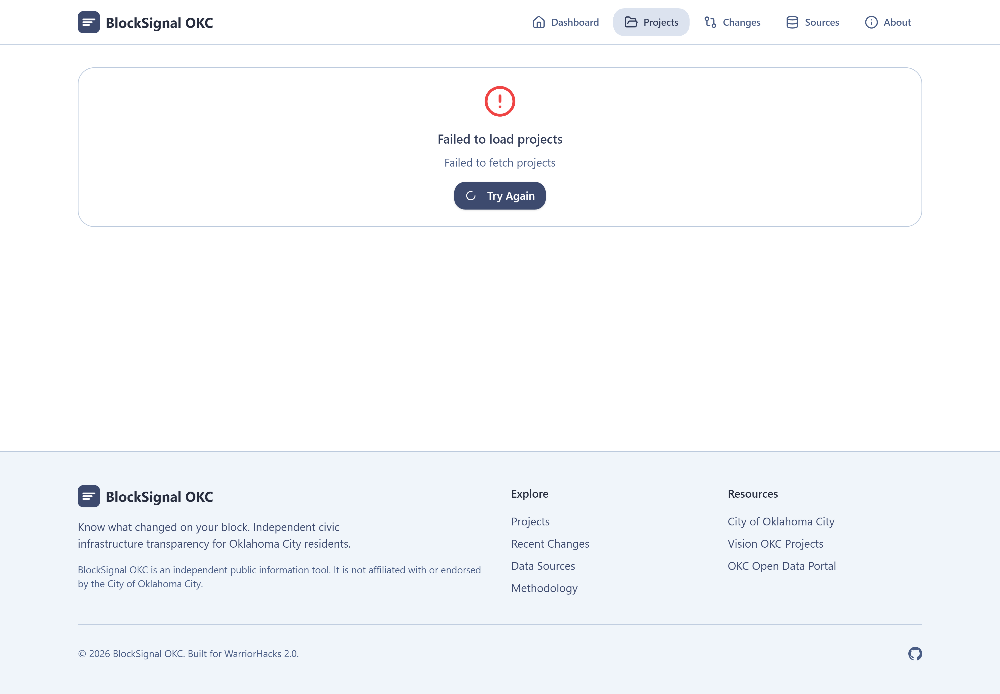
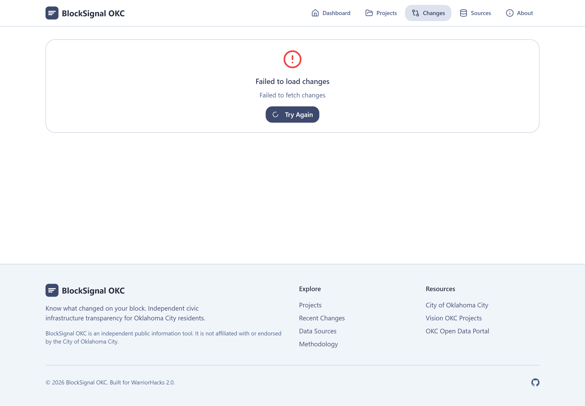
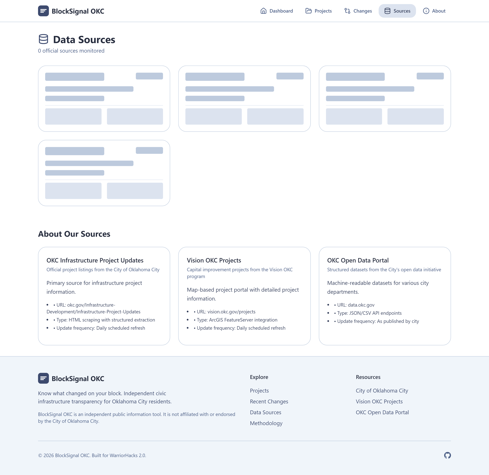

# BlockSignal OKC

**Know what changed on your block.** Independent civic infrastructure transparency for Oklahoma City residents.



## Overview

Public infrastructure and planning information for Oklahoma City is spread across multiple government webpages, project portals, maps, PDFs, and separate agency pages. Finding a project is one problem; understanding what has changed since the last available public record is another.

BlockSignal OKC collects data from verified official sources, normalizes it into a consistent schema, and tracks material field-level changes between snapshots. Every change links to the original government record so residents can verify information directly.

## Screenshots

| Homepage | Project Explorer |
|----------|------------------|
|  |  |

| Change Feed | Source Directory |
|-------------|------------------|
|  |  |

| Mobile View | About / Methodology |
|-------------|---------------------|
|  |  |

## Features

- **Project Explorer** - Search and filter infrastructure projects by name, location, status, type, and source
- **Change Feed** - Reverse-chronological feed of material field-level changes with before/after values
- **Project Details** - Complete project information with full change history and source links
- **Source Directory** - All monitored data sources with health status, last refresh times, and error reporting
- **Source-Backed Change Detection** - Every change links to the original government record
- **PWA Support** - Installable as a Progressive Web App with offline capability
- **Mobile-First** - Responsive design with touch-friendly controls
- **Accessible** - Semantic HTML, keyboard navigation, screen reader support

## How Change Detection Works

The core of BlockSignal is its deterministic, snapshot-based change detection:

1. **Fetch** - Retrieve records from official sources via adapters (HTML scraper, ArcGIS FeatureServer, JSON API)
2. **Validate** - Validate against Zod schemas, reject malformed records
3. **Normalize** - Convert to consistent schema while preserving meaning (trim whitespace, normalize dates, standardize numbers)
4. **Match** - Match to existing projects by stable external ID; conservative matching prevents incorrect merges
5. **Snapshot** - Create immutable snapshot with content fingerprint (hash of all structured fields)
6. **Compare** - Field-level diff against previous accepted snapshot; ignore volatile fields (timestamps, formatting, HTML)
7. **Record** - Create ChangeEvents for material differences with classification (status, schedule, funding, scope, location, document, metadata)
8. **Deduplicate** - Stable deduplication keys prevent duplicate events

### Idempotency

- Identical refreshes produce no new snapshots or events
- Failed refreshes never overwrite valid data
- Refresh runs are transactional

### Transparency

Every ChangeEvent includes:
- Project reference
- Previous and new snapshot IDs
- Field name and both values
- First observation timestamp (when BlockSignal detected the change)
- Previous observation timestamp (when the old value was last confirmed)
- Source URL for verification
- Classification
- Deduplication key

## Data Sources

| Source | Type | Status | URL |
|--------|------|--------|-----|
| OKC Infrastructure Project Updates | HTML Scraper | Configured | <https://www.okc.gov/Infrastructure-Development/Infrastructure-Project-Updates> |
| Vision OKC Projects | ArcGIS FeatureServer | Configured | <https://vision.okc.gov/projects> |
| OKC Open Data Portal | JSON API | Configured (disabled by default) | <https://data.okc.gov> |

### Limitations

- **No pre-monitoring history** - Changes before first observation are unknown
- **Source-dependent** - Can only track fields present in source data
- **Pagination and API limits** - A missing record in one response does not mean deletion
- **Not official** - Independent tool, not affiliated with City of Oklahoma City
- **Verify directly** - Always check original sources for critical decisions

## Technology Stack

- **Framework**: Next.js 14 (App Router)
- **Language**: TypeScript (strict mode)
- **Styling**: Tailwind CSS
- **Database**: PostgreSQL with Prisma ORM
- **Validation**: Zod
- **Testing**: Vitest (unit/integration), Playwright (E2E)
- **Icons**: Lucide React
- **Deployment**: Vercel-ready

## Run Locally

### Prerequisites

- Node.js 20+
- PostgreSQL 15+
- npm or pnpm

### Installation

```bash
# Clone the repository
git clone https://github.com/FlashSpeedie/blocksignal-okc.git
cd blocksignal-okc

# Install dependencies
npm ci

# Set up environment variables
cp .env.example .env.local
# Edit .env.local with your database URL and other settings

# Set up the database
npm run db:generate
npm run db:push
npm run db:seed

# Start development server
npm run dev
```

The application will be available at `http://localhost:3000`.

### Environment Variables

| Variable | Required | Description |
|----------|----------|-------------|
| `DATABASE_URL` | Yes | PostgreSQL connection string |
| `NEXT_PUBLIC_APP_URL` | Yes | Application URL (e.g., `http://localhost:3000`) |
| `CRON_SECRET` | Yes | Secret for securing cron refresh endpoint |
| `NEXT_PUBLIC_SUPABASE_URL` | No | Supabase project URL (for production) |
| `NEXT_PUBLIC_SUPABASE_ANON_KEY` | No | Supabase anon key (for production) |
| `SUPABASE_SERVICE_ROLE_KEY` | No | Supabase service role key (server-only) |
| `OKC_OPEN_DATA_TOKEN` | No | API token for OKC Open Data Portal |
| `ARC_GIS_TOKEN` | No | Token for ArcGIS FeatureServer (if private) |
| `ENABLE_DEMO_MODE` | No | Enable demo data (default: false) |

### Database Commands

```bash
# Generate Prisma client
npm run db:generate

# Push schema to database (development)
npm run db:push

# Run migrations (production)
npm run db:migrate

# Open Prisma Studio
npm run db:studio

# Seed initial data sources
npm run db:seed
```

## Testing

```bash
# Unit and integration tests
npm run test

# Test with UI
npm run test:ui

# E2E tests (requires dev server running)
npm run test:e2e

# Type checking
npm run typecheck

# Linting
npm run lint
```

### Test Results

- **Unit/Integration Tests**: 31 tests passing (3 test files)
- **Type Checking**: Passed
- **Linting**: Passed (warnings only)
- **Production Build**: Successful

## Source Refresh & Scheduling

### Manual Refresh

```bash
# Refresh all sources
npm run refresh

# Or trigger via API (requires CRON_SECRET)
curl -X GET http://localhost:3000/api/cron/refresh \
  -H "Authorization: Bearer YOUR_CRON_SECRET"
```

### Automated Scheduling

#### Vercel Cron Jobs (Recommended)

Create `vercel.json`:

```json
{
  "crons": [
    {
      "path": "/api/cron/refresh",
      "schedule": "0 */6 * * *"
    }
  ]
}
```

#### Traditional Cron

```bash
# Every 6 hours
0 */6 * * * curl -X GET https://your-domain.com/api/cron/refresh -H "Authorization: Bearer YOUR_CRON_SECRET"
```

#### GitHub Actions

```yaml
name: Refresh Sources
on:
  schedule:
    - cron: '0 */6 * * *'
jobs:
  refresh:
    runs-on: ubuntu-latest
    steps:
      - uses: actions/checkout@v4
      - uses: actions/setup-node@v4
        with:
          node-version: '20'
      - run: npm ci
      - run: npm run refresh
        env:
          DATABASE_URL: ${{ secrets.DATABASE_URL }}
          CRON_SECRET: ${{ secrets.CRON_SECRET }}
```

## Deployment

### Vercel (Recommended)

1. Push to GitHub
2. Import project in Vercel
3. Add environment variables
4. Deploy

Vercel automatically detects Next.js and configures the build.

### Docker

```dockerfile
FROM node:20-alpine AS builder
WORKDIR /app
COPY package*.json ./
RUN npm ci
COPY . .
RUN npm run build

FROM node:20-alpine AS runner
WORKDIR /app
ENV NODE_ENV=production
COPY --from=builder /app/public ./public
COPY --from=builder /app/.next/standalone ./
COPY --from=builder /app/.next/static ./.next/static
EXPOSE 3000
CMD ["node", "server.js"]
```

Add to `next.config.js`:
```js
const nextConfig = {
  output: 'standalone',
  // ... other config
};
```

### Database

For production, use a managed PostgreSQL service:
- Supabase (PostgreSQL with connection pooling)
- Neon (serverless PostgreSQL)
- Railway, Render, or AWS RDS

Run migrations before deploying:
```bash
npx prisma migrate deploy
```

## Disclaimer

BlockSignal OKC is an independent public information tool. It is not affiliated with, endorsed by, or connected to the City of Oklahoma City or any government agency. All data is sourced from publicly available government publications. Users should verify critical information directly with official sources.

## License

MIT License - Built for WarriorHacks 2.0